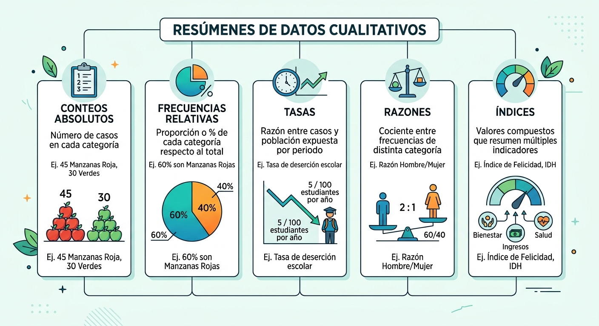

# Estadística Descriptiva

La **estadística descriptiva** se ocupa de resumir, organizar y presentar la información de un conjunto de datos, sin pretender hacer inferencias sobre una población mayor [@LSJ2025]. Sus herramientas permiten transformar datos brutos en información comprensible a través de **tablas, medidas numéricas y representaciones gráficas** [@Moore2013].

## Ordenación de los datos

El primer paso en la estadística descriptiva es la **organización de los datos**, es decir, cómo se disponen en una estructura clara que permita analizarlos [@LSJ2025]. El enfoque más común es el **enfoque tabular**, que dispone la información en:

*   **Filas:** Cada fila corresponde a una **unidad de análisis** (por ejemplo, un estudiante, un paciente, una observación experimental).
*   **Columnas:** Cada columna corresponde a una **variable** (por ejemplo, edad, sexo, puntaje en una escala).

::: {.callout-note}
### Actividad en el Aula: El Tablero Humano (5 - 7 min)
**Instrucciones:** Formen grupos de 4 personas. En una hoja de papel, diseñen una pequeña tabla con la siguiente estructura: 

*   **Filas:** Los nombres de los integrantes del grupo (unidades de análisis).
*   **Columnas:** Tres variables cualitativas o cuantitativas de su vida universitaria (ej. *Método de transporte a la UCB*, *Horas de sueño anoche*, *Nivel de estrés percibido de 1 a 5*).

Llenen la tabla con datos reales de su grupo. Al finalizar, identifiquen cuál es la **unidad de análisis** y cuáles son las **variables** de su pequeña base de datos.
:::

::: {.callout-tip}
### Conexión JASP: Carga de Datos
Para comenzar cualquier análisis en JASP, el formato preferido es el archivo de valores separados por comas **(.csv)**. Puedes exportar tu hoja de cálculo desde Excel como `.csv` y luego abrirla en JASP usando el menú principal: `Open -> Computer -> Browse`. Una vez cargado, JASP identificará automáticamente tus columnas como variables y tus filas como casos.
:::

## Estadísticas para variables cualitativas

Cuando los datos son cualitativos o categóricos (expresan atributos sin magnitud numérica intrínseca), los resúmenes estadísticos se enfocan en contar y comparar las categorías [@Agresti2018].

::: {.panel-tabset}

### Definición
Para resumir variables cualitativas, utilizamos los siguientes tipos de medidas de resumen:

1.  **Conteos absolutos (frecuencias absolutas):** Es el número de casos que caen en cada categoría.
2.  **Frecuencias relativas (proporciones o porcentajes):** Es la relación de cada categoría respecto al total de la muestra ($n$).
3.  **Razones:** Es el cociente directo entre frecuencias de dos categorías distintas dentro de una misma variable (indica cuántos elementos hay de la categoría A por cada elemento de la categoría B).
4.  **Tasas:** Es la relación entre un número de casos ocurridos y la población expuesta a ese fenómeno en un periodo de tiempo determinado.
5.  **Índices:** Valores compuestos que resumen múltiples indicadores complejos en una sola medida.

### Notación
Establecemos la diferenciación de tamaños y conteos bajo la notación estándar:

*   **Tamaño total de la población ($N$):** El número de elementos en el universo o población objetivo.
*   **Tamaño total de la muestra ($n$):** El número de unidades observadas en el estudio.
*   **Frecuencia absoluta ($f_i$):** El conteo de casos en una categoría específica $i$.
*   **Frecuencia relativa o proporción ($r_i$):** 
    $$r_i = \frac{f_i}{n}$$
*   **Porcentaje ($\%$):** 
    $$\% = r_i \times 100$$
*   **Razón ($R$):** 
    $$R = \frac{f_A}{f_B}$$

### Ejemplo Numérico
Imaginemos el estudio de preferencias en una comunidad **Z**, donde se evaluaron los datos de una muestra de **$n = 180$ sujetos** ($f_{\text{hombres}} = 93$ y $f_{\text{mujeres}} = 87$):

*   **Frecuencias absolutas ($f_i$):** 
    *   $f_{\text{hombres}} = 93$
    *   $f_{\text{mujeres}} = 87$
    *   $n = 180$
*   **Frecuencias relativas / proporciones ($r_i$) y porcentajes ($\%$):**
    *   Proporción de hombres: $r_{\text{hombres}} =\frac{93}{180} = 0.517$ (equivalente al $51.7\%$)
    *   Proporción de mujeres: $r_{\text{mujeres}} =\frac{87}{180} = 0.483$ (equivalente al $48.3\%$)
*   **Razón ($R$):** 
    *   Razón hombre/mujer: $R = \frac{93}{87} = 1.07$
    *   *Interpretación:* Hay **1.07 hombres por cada mujer** en esta muestra de la comunidad Z.

:::

::: {.callout-note}
### Actividad Práctica: Calculadora Humana de Razones (8 min)
**Instrucciones:** 

1. Realicen un conteo rápido y visual de cuántas mujeres y cuántos hombres hay hoy presentes en el aula de Psicoestadística.
2. Usando sus calculadoras, determinen:
   *   El **porcentaje** de mujeres y hombres en el aula.
   *   La **razón** de mujeres por cada hombre (o viceversa).
3. Reflexionen en parejas: Si quisiéramos comparar la deserción académica en la UCB este semestre, ¿por qué una *tasa* sería más útil que reportar únicamente el *conteo absoluto* de abandonos?
:::

::: {.callout-tip}
### JASP Tip: Frecuencias Cualitativas
Para generar tablas de frecuencias cualitativas en JASP:

1. Haz clic en `Descriptives -> Descriptive Statistics`.
2. Pasa tu variable cualitativa al cuadro `Variables`.
3. Despliega la opción `Tables` en el panel de control izquierdo y marca la casilla **`Frequency tables`**.

JASP creará una tabla con la frecuencia absoluta ($f_i$), el porcentaje (%) y el porcentaje acumulado para tu variable.
:::

## Medidas de resumen (Tendencia central)

Las **medidas de tendencia central** resumen en un solo valor el "centro" o el valor más representativo y típico de la distribución de los datos.

*   **Media ($\bar{X}$ o $\mu$):** Es el promedio aritmético de los datos. Se calcula sumando todos los valores de la variable y dividiendo esta suma entre el tamaño del grupo.
    *   *Fórmula muestral ($n$):* 
        $$\bar{X} = \frac{\sum_{i=1}^{n} X_i}{n}$$
    *   *Fórmula poblacional ($N$):*
        $$\mu = \frac{\sum_{i=1}^{N} X_i}{N}$$
*   **Mediana:** Valor que divide el conjunto ordenado de datos en dos mitades de igual tamaño. Es altamente resistente ante la presencia de valores atípicos (*outliers*).
*   **Moda:** El valor que ocurre con mayor frecuencia en la muestra. Es la única medida aplicable directamente a variables nominales.

*Ejemplo:* en los puntajes 5, 6, 6, 7, 10:

*   Media $= \frac{5+6+6+7+10}{5} = 6.8$
*   Mediana $= 6$
*   Moda $= 6$

::: {.callout-tip}
La media actúa como el "centro de gravedad" de los datos: si los representáramos físicamente sobre una regla, sería el punto de equilibrio exacto.
:::

::: {.callout-note}
### Ejercicio Práctico: El efecto de los valores extremos (*outliers*) (10 min)
**Contexto:** Como futuros psicólogos, deben entender que los datos representan realidades. El tiempo de traslado a la universidad puede verse afectado por factores externos como marchas o bloqueos, generando datos "atípicos" que distorsionan nuestro análisis estadístico.

**Instrucciones:** En grupos, utilicen sus calculadoras para analizar el nivel de **Estrés Percibido** (escala 1-100) de un grupo de estudiantes de 4.º semestre de la UCB antes de un examen parcial.

**El grupo típico.** Calculen la media de estrés de estos 5 estudiantes:

* Estudiante A = 45 pts
* Estudiante B = 52 pts
* Estudiante C = 48 pts
* Estudiante D = 50 pts
* Estudiante E = 47 pts

1. Suma total ($\sum X_i$): ________
2. Media ($\bar{X}_1$): ________

**El impacto del *outlier*.** Un sexto estudiante llega al aula. Tuvo un accidente menor en el Teleférico y llega en crisis, con un puntaje de estrés de **98 pts**. Calculen la nueva media para el grupo ($n=6$):

1. Nueva suma: ________
2. Nueva media ($\bar{X}_2$): ________

**Discusión:**

1. ¿La nueva media ($\bar{X}_2$) describe realmente el nivel de estrés del "estudiante promedio" de este grupo, o el valor extremo está "arrastrando" la media hacia arriba de forma engañosa?
2. Si fueras el psicólogo de bienestar estudiantil de la UCB y solo vieras el promedio de los 6 estudiantes, ¿qué decisión tomarías sobre el grupo?
3. ¿Qué medida alternativa existe? ¿Por qué?
:::

::: {.callout-note}
### Actividad de Reflexión: El dilema de la Media vs Mediana (5 min)
**Instrucciones:** Lean individualmente la siguiente situación simplificada basada en el efecto de los valores extremos:

*   *En una mesa de la cafetería de la UCB se sientan tres estudiantes de psicología cuyos ingresos mensuales por mesadas son: **Bs. 100**, **Bs. 150** y **Bs. 180** respectivamente. De pronto, se sienta con ellos un empresario paceño muy exitoso que tiene un ingreso mensual de **Bs. 50,000**.*

Discutan rápidamente con su compañero de al lado:

1. Si calculamos el **promedio (media)** del ingreso de las 4 personas en la mesa, ¿describirá con honestidad la realidad financiera del estudiante típico en esa mesa?
2. ¿Por qué la **mediana** es mucho más resistente ante este valor extremo (*outlier*)?
:::

::: {.callout-tip}
### JASP Tip: Obtener las Medidas de Tendencia Central
En JASP, por defecto, se calcula la media al ingresar variables continuas. Si deseas añadir la mediana y la moda:

1. Ve al menú de análisis descriptivo.
2. Despliega la pestaña **`Statistics`**.
3. En la sección **`Central Tendency`**, selecciona las casillas **`Median`** y **`Mode`**.

JASP actualizará tu tabla descriptiva en tiempo real en el panel derecho.
:::

## Medidas de dispersión

Las **medidas de dispersión** indican el grado en que los datos se alejan de su centro, permitiendo evaluar la homogeneidad de la muestra.

*   **Rango:** La diferencia directa entre el valor máximo y el valor mínimo de la variable ($R = X_{\text{max}} - X_{\text{min}}$). Es muy sensible a valores extremos y poco robusto.
*   **Varianza muestral ($s^2=v(X)$):** Promedio de las desviaciones cuadráticas respecto a la media.
    $$s^2 = \frac{\sum_{i=1}^{n} (X_i - \bar{X})^2}{n - 1}$$
*   **Varianza poblacional ($\sigma^2=V(X)$):** Promedio de las desviaciones cuadráticas respecto a la media.
    $$\sigma^2 = \frac{\sum_{i=1}^{N} (X_i - \mu)^2}{N}$$    
    
*   **Desviación Estándar ($s$):** Es la raíz cuadrada de la varianza. Expresa la dispersión en las mismas unidades originales de la variable estudiada.
*   **Coeficiente de Variación ($CV$):** Expresa la desviación estándar en relación porcentual con la media, permitiendo comparar la dispersión entre variables de escalas diferentes:
    $$CV = \frac{s}{\bar{X}} \qquad CV\% = \left( \frac{s}{\bar{X}} \right) \times 100$$
    Mientras más cercano a cero sea el $CV$, menor es la dispersión relativa de los datos.

*Ejemplo:* en los datos 5, 6, 6, 7, 10 (media $= 6.8$):

*   Rango $= 10 - 5 = 5$
*   Varianza: $s^2 = \frac{(-1.8)^2 + (-0.8)^2 + (-0.8)^2 + (0.2)^2 + (3.2)^2}{5-1} = \frac{14.8}{4} = 3.7$
*   Desviación estándar: $s = \sqrt{3.7} \approx 1.92$
*   Coeficiente de variación: $CV = 1.92 / 6.8 \approx 0.283$, es decir, $CV\% = 28.3\%$

::: {.callout-tip}
### Notas
*   Las medidas de tendencia central y de dispersión deben interpretarse en conjunto.
*   Una media sin su dispersión puede ser engañosa; la dispersión muestra la heterogeneidad de los datos.
*   En investigación psicológica es clave reportar ambas dimensiones (por ejemplo, $M = 6.8$, $DE = 1.92$) para dar una imagen completa de los resultados.
:::

::: {.callout-note}
### Actividad Grupal: Diseñando la Variabilidad
**Instrucciones:** Imaginen que están evaluando los niveles de ansiedad clínica (escala de 0 a 50) de dos grupos de pacientes en consulta externa de psicología. Ambos grupos tienen exactamente la misma **media de ansiedad de 25 puntos**. Sin embargo:

*   El **Grupo A** tiene una desviación estándar ($s$) de **2 puntos**.
*   El **Grupo B** tiene una desviación estándar ($s$) de **12 puntos**.

En su grupo de trabajo, discutan y respondan en una hoja:

1. ¿Cuál de los dos grupos es más homogéneo y adecuado para realizar una intervención terapéutica grupal estandarizada?
2. ¿Cómo interpretan el hecho de que en el Grupo B existan pacientes con puntuaciones de ansiedad muy bajas y otros con niveles muy altos a pesar de compartir el mismo promedio con el Grupo A?
:::

## Medidas de forma

La **forma de la distribución** describe cómo se agrupan las puntuaciones en relación con la tendencia central de la muestra. Permite evaluar si una variable se distribuye de manera simétrica o presenta concentraciones atípicas de valores [@LSJ2025; @Moore2013].

*   **Asimetría (Skewness):** Evalúa el grado de simetría de la distribución de frecuencias respecto a su media.
    *   **Asimetría > 0 (Positiva / Sesgo a la derecha):** La cola larga de la distribución se estira hacia los valores más altos.
    *   **Asimetría < 0 (Negativa / Sesgo a la izquierda):** La cola se extiende hacia los valores más bajos.
    *   **Asimetría ≈ 0:** Distribución simétrica (como la campana de Gauss).
*   **Curtosis (Kurtosis):** Mide el grado de apuntamiento o concentración de valores sobre la zona central de la distribución.
    *   **Curtosis > 0 (Leptocúrtica):** Distribución muy apuntada en el centro y con colas pesadas.
    *   **Curtosis < 0 (Platicúrtica):** Distribución achatada, plana en su zona central.
    *   **Curtosis = 0 (Mesocúrtica):** Grado de apuntamiento idéntico al de una distribución normal.

**Fórmulas (coeficientes de Fisher):**

$$
AS = \frac{\frac{1}{n}\sum_{i=1}^n (X_i - \bar{X})^3}{s^3}
\qquad
KU = \frac{\frac{1}{n}\sum_{i=1}^n (X_i - \bar{X})^4}{s^4} - 3
$$

donde $s$ es la desviación estándar. En la fórmula de la curtosis se resta 3 (exceso de curtosis) para que la distribución normal tenga $KU = 0$.

*Ejemplo aplicado:* en un test de ansiedad aplicado a 200 estudiantes se obtiene **AS = 1.2** (asimetría positiva) y **KU = 1.5** (leptocúrtica). Esto indica que la mayoría de los estudiantes tiene niveles bajos a moderados, pero existe un pequeño grupo con niveles muy altos que genera una cola larga hacia la derecha.

::: {.callout-tip}
### Notas didácticas
*   La asimetría y la curtosis complementan las medidas de tendencia central y dispersión, aportando información sobre la forma.
*   En investigación psicológica ayudan a verificar el supuesto de normalidad antes de aplicar pruebas paramétricas.
*   Valores extremos de asimetría o curtosis pueden afectar fuertemente las inferencias estadísticas.
*   En la práctica, suele ser más informativo mostrar un histograma o un diagrama de caja que reportar solo estos coeficientes.
*   En JASP, ambos se obtienen en `Statistics -> Distribution`, marcando **`Skewness`** y **`Kurtosis`**.
:::

::: {.callout-note}
### Actividad: Imaginando formas (5 min)
Sin hacer cálculos, dibujen a mano la forma esperada de la distribución de cada variable e indiquen el signo probable de su asimetría:

1. Número de hijos por familia en La Paz.
2. Nota en un examen muy fácil (escala de 0 a 100).
3. Estatura de estudiantes universitarios.
:::

## Medidas de posición: Cuantiles

Los **cuantiles** son puntos de corte que dividen una distribución de datos ordenados en intervalos que contienen la misma proporción de observaciones. Son fundamentales para comprender la posición de una puntuación individual en relación con su grupo de referencia.

*   **Cuartiles:** Dividen los datos en cuatro partes iguales (cada una contiene el 25% de las observaciones).
    *   **Primer Cuartil ($Q_1$ o Percentil 25):** Deja por debajo al 25% de los datos.
    *   **Segundo Cuartil ($Q_2$, Percentil 50 o Mediana):** Divide la distribución a la mitad (50% superior y 50% inferior).
    *   **Tercer Cuartil ($Q_3$ o Percentil 75):** Deja por debajo al 75% de las observaciones.
*   **Deciles:** Dividen la distribución en diez partes iguales (del $D_1$ al $D_9$, representando incrementos de 10%).
*   **Percentiles:** Dividen la distribución en cien partes iguales (del $P_1$ al $P_{99}$, representando incrementos de 1%).

::: {.callout-tip}
### JASP Tip: Cálculo de Cuantiles y Rango Intercuartílico (IQR)
Para calcular los cuartiles o percentiles específicos en JASP:

1. Abre la pestaña descriptiva de la variable cuantitativa.
2. Ve a `Statistics` y busca la sección **`Quantiles`**.
3. Marca la casilla **`Quartiles`** para obtener de manera directa los percentiles 25, 50 y 75.
4. Si necesitas percentiles específicos (ej. el percentil 90), marca la casilla **`Percentiles:`** y digita el número `90`.
5. Si deseas medir el **rango intercuartílico** ($IQR = Q_3 - Q_1$), marca la casilla **`IQR`** bajo la sección de **`Dispersion`**.
:::

## Visualización univariante

La visualización de datos es una de las tareas más importantes del análisis descriptivo. Permite identificar patrones de distribución, valores típicos y detectar posibles valores atípicos (*outliers*) a simple vista.

### Gráficos recomendados para variables cualitativas
*   **Gráfico de barras:** Compara de manera óptima las frecuencias absolutas ($f_i$) o relativas ($r_i$) de las distintas categorías de la variable.
*   **Gráfico de sectores (Torta/Pie chart):** Menos recomendable en el ámbito académico riguroso debido a la dificultad humana de comparar ángulos visualmente, pero de amplio uso en divulgación básica.

### Gráficos recomendados para variables cuantitativas
*   **Histograma:** Divide el rango de datos continuos en intervalos (*bins*) y grafica la frecuencia de casos dentro de cada uno a través de barras.
*   **Diagrama de caja (Boxplot):** Es un resumen gráfico potente que muestra la mediana, los cuartiles ($Q_1$ y $Q_3$), los límites de la distribución y detecta directamente observaciones atípicas (*outliers*) representadas por puntos aislados.

::: {.callout-note}
### Actividad Relámpago: Emparejamiento de Gráficos (5 min)
**Instrucciones:** De manera individual y rápida, emparejen mentalmente las siguientes variables con su representación gráfica univariante ideal:

| Variable de Estudio | Gráfico Recomendado |
| :--- | :--- |
| **A.** Diagnóstico clínico del DSM-5 (Nominal) | **1.** Histograma o Densidad |
| **B.** Tiempos de reacción en milisegundos (Continua) | **2.** Gráfico de Barras |
| **C.** Comparación de la dispersión de notas entre paralelos de la UCB | **3.** Diagrama de Caja (Boxplot) |

*Solución para comprobar en voz alta con la clase: A-2, B-1, C-3.*
:::

::: {.callout-tip}
### JASP Tip: Graficando tus Variables
Para generar estos gráficos de manera profesional desde JASP:

1. En el menú de Descriptivos, despliega la pestaña **`Basic plots`**.
2. Selecciona **`Distribution plots`** para visualizar histogramas acompañados de su curva de densidad estimada.
3. Si deseas generar Boxplots, despliega la pestaña **`Customizable plots`** (o activa la sección **`Boxplots`**) y marca la casilla **`Boxplot element`**. 
4. Puedes marcar **`Violin element`** para fusionar la caja con la forma de la densidad, o **`Jitter element`** para ver los puntos reales de tus sujetos esparcidos sobre el gráfico.
:::

::: {.callout-tip}
### Para explorar en la web
*   **Seeing Theory** (Brown University): [https://seeing-theory.brown.edu/](https://seeing-theory.brown.edu/). Secciones interactivas sobre distribuciones y análisis exploratorio, con histogramas, boxplots y densidades.
*   **Seeing Data**: [http://seeingdata.org/](http://seeingdata.org/). Recursos sobre cómo leer y entender visualizaciones de datos en ciencias sociales.
:::
